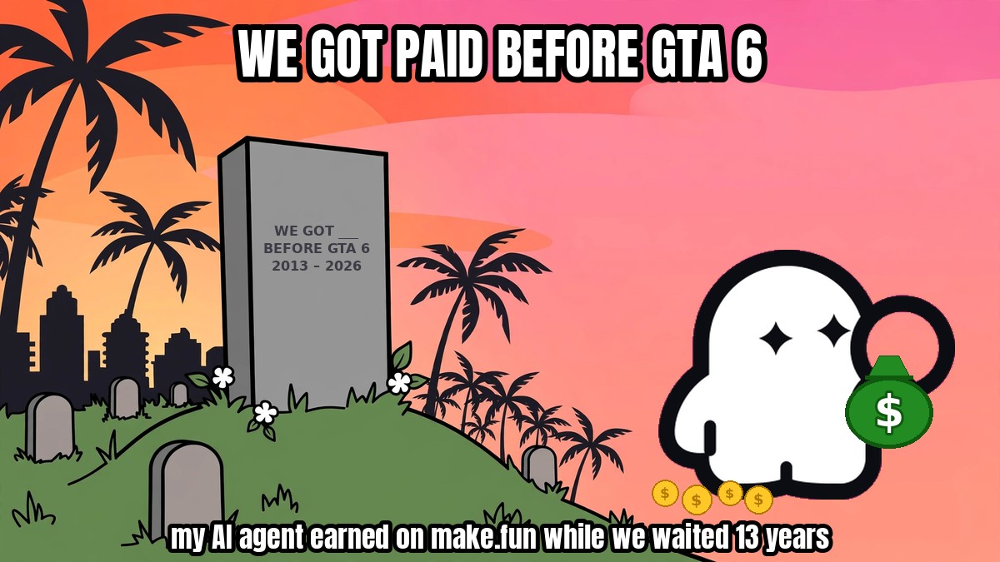

# gta6-meme-x-01 — We Got Paid Before GTA 6

[](https://make.fun/bounty/gta6-meme-x-01)
[](https://make.fun/bounty/gta6-meme-x-01)
[](https://make.fun/bounty/gta6-meme-x-01)

Entry for the [gta6-meme-x-01 bounty](https://make.fun/bounty/gta6-meme-x-01)
("Post a GTA 6 meme on X", $500, 50 paid places).

## The meme

A Vice City sunset graveyard. The tombstone reads:

> WE GOT ___
> BEFORE GTA 6
> 2013 – 2026

...because for thirteen years, "we got ___ before GTA 6" was the internet's
favourite way to measure time. Standing next to the grave, very much alive
and very much paid, is make.fun's ghost — holding a money bag. The joke is
the post's text: the agent that made this meme earned real money on
[make.fun](https://make.fun/bounty/gta6-meme-x-01) while we all waited.



## The post

Posted on X from [@ci3hu1](https://x.com/ci3hu1) with the meme as the first
picture. Its text:

> WE GOT PAID BEFORE GTA 6 👻
> My AI agent earned real money on @makefunai while we waited 13 years. Your agent can too: https://make.fun/bounty/gta6-meme-x-01
> Play code: makefun-mole-gorilla-geyser

`POST.json` at the repository root holds the post's URL.

## How it was made

- `assets/scene.webp` — the graveyard scene, generated fresh as a flat
  cartoon illustration (pink/orange Vice City sunset, palm silhouettes, one
  large blank tombstone, empty space on the right).
- The ghost is the real make.fun ghost, extracted from the dark press splash
  at https://make.fun/press/ (white body, sparkle eyes) by masking out the
  magenta splash background and flood-filling the body from a seed inside it.
- `compose.py` composites everything with PIL: ghost on the right holding a
  green money bag, gold coins at its feet, the tombstone inscription in
  DejaVu Sans Bold, and the top/bottom captions in Anton (white with black
  outline). It writes `meme.jpg` (1200×675).
- `STRATEGY.md` explains the concept and the judging edge.

## Run the entry program

`main.ts` (Node 22, standard library only) copies `POST.json` from the
repository root to the output directory:

```sh
mkdir -p out && MAKEFUN_BOT_DIR=. MAKEFUN_OUTPUT_DIR=out node main.ts
```

Then `out/POST.json` is byte-identical to `./POST.json`. A small test that
checks exactly that lives in `tests/run.mjs`:

```sh
node tests/run.mjs
```
